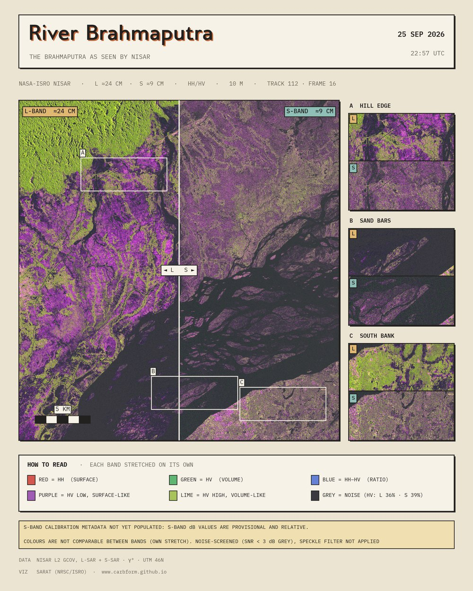
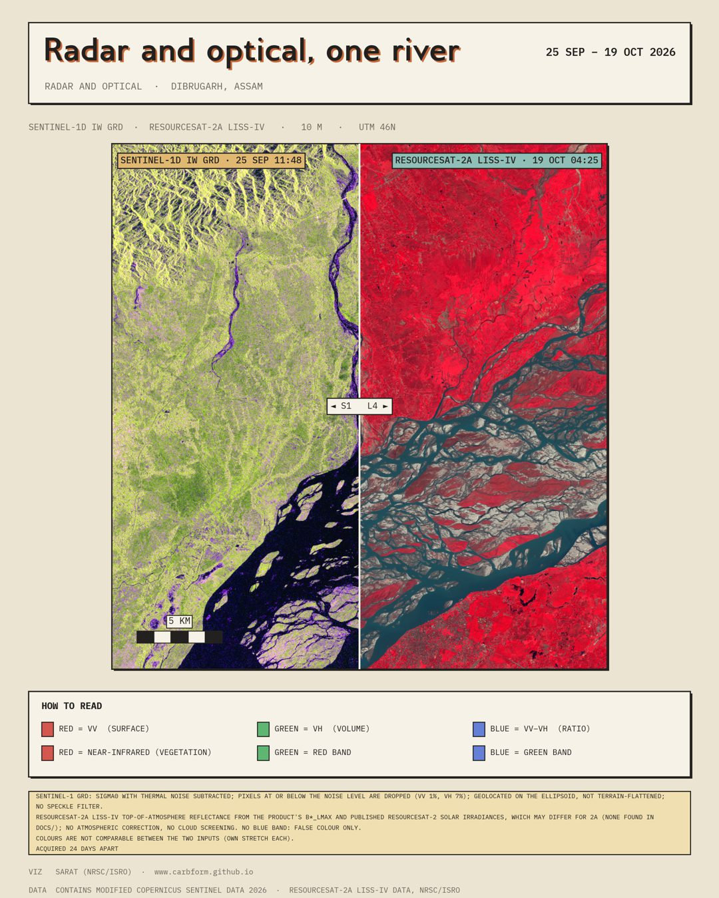

# satmaps

Print-ready figures from satellite data, one product or two that overlap: **SAR** (NISAR, Sentinel-1, EOS-04) and **optical** (Sentinel-2, LISS-IV). Local only: nothing is uploaded.

<p align="center">
  
  
</p>

## Install

Python 3.11 or newer.

```bash
git clone https://github.com/carbform/nisar-ls-viz && cd nisar-ls-viz
pip install -e ".[rasters,app]"
```

## Use

Unzip your products into `data/` (or set `SATMAPS_DATA_DIR`, or pass `--data-dir`). Then either open the app:

```bash
satmaps app                                 # http://localhost:8501
```

or make a figure from the command line:

```bash
satmaps quick a.h5 b.SAFE                   # a small PNG of the area the two products share
satmaps quick a.h5 b.SAFE --quality publication --theme newspaper
satmaps quick a.h5 --sar-fcc cross,co,ratio # false colour composite: which channel goes on R, G, B
satmaps quick b.SAFE --optical-fcc nir,red,green
satmaps quick a.h5 b.SAFE --save-job fig.toml   # also save the job file; edit it, then `satmaps run fig.toml`
```

```python
import satmaps
satmaps.render(["a.h5", "b.SAFE"], theme="newspaper", quality="publication", title="Two radars")
```

`satmaps --help` lists the other commands (`inspect`, `run`, `init`, `list`). Job files and the wording files that change what a figure says are in [jobs/](jobs/).

## Caveats

The NISAR S-band product is still unfinished: its calibration is unpopulated and noise is not subtracted. Noise-dominated pixels are drawn grey and every figure prints the caveats. Read [docs/processing-notes.md](docs/processing-notes.md) before quoting a number.

More: [architecture](docs/architecture.md) · [pipelines](docs/pipelines.md) · [design language](docs/design-language.md)

## Licence

Code: MIT, see [LICENSE](LICENSE). Data and source documents belong to their providers; figures made from NISAR data should credit "NASA-ISRO NISAR".
