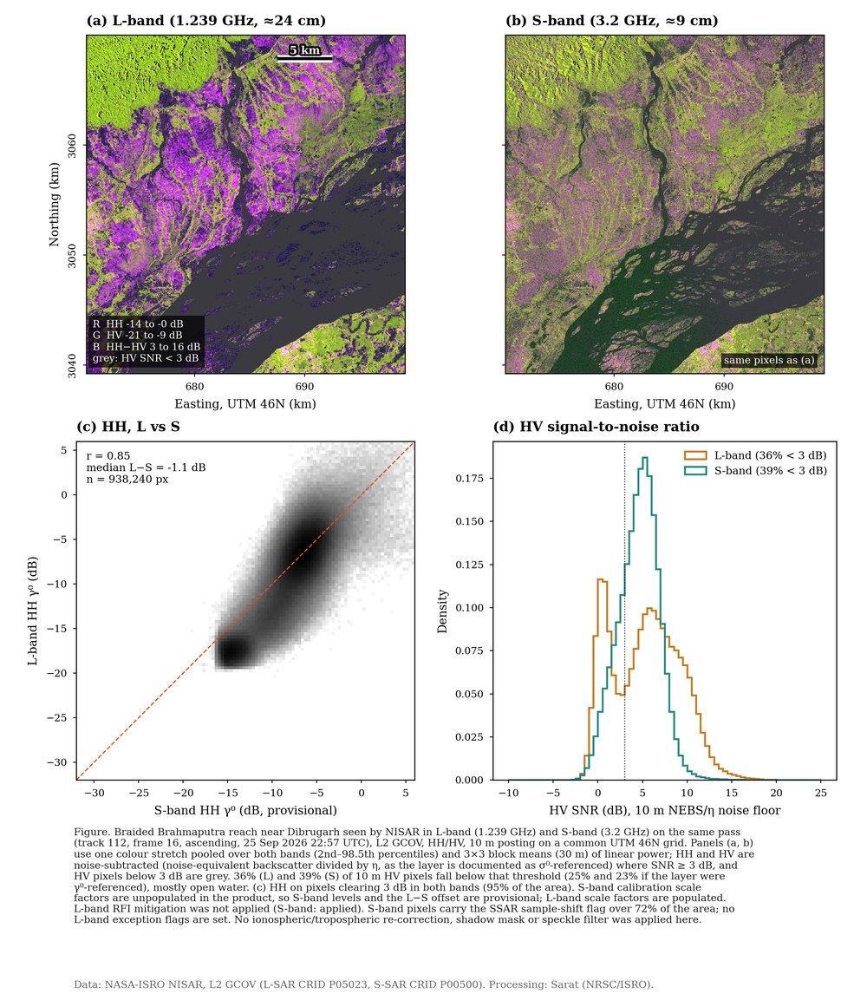
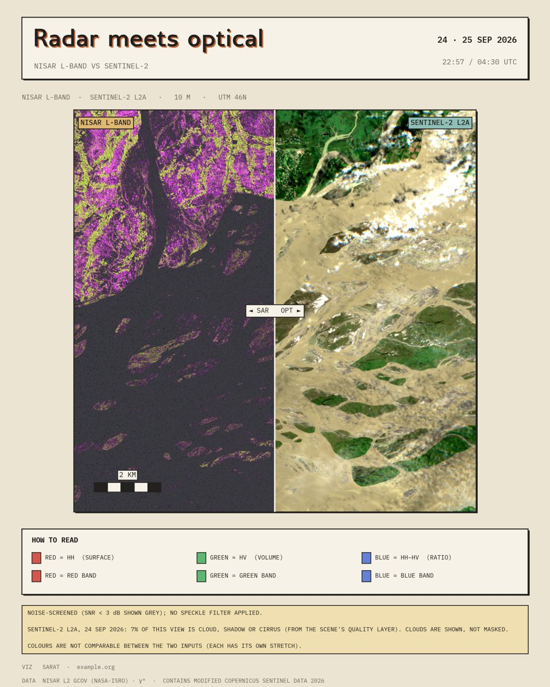
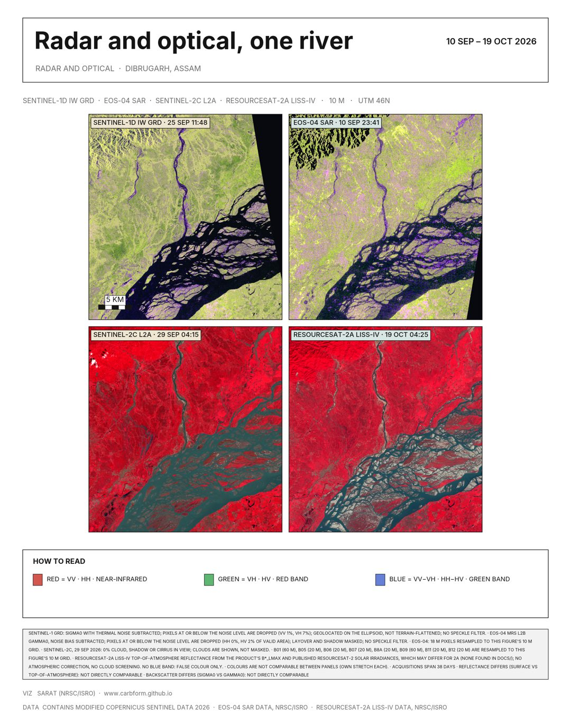
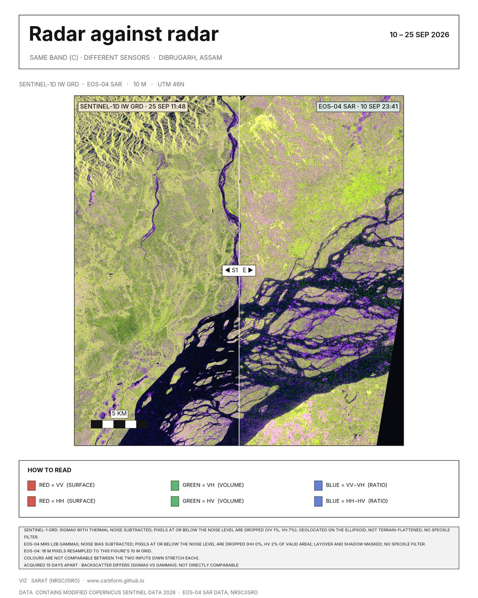
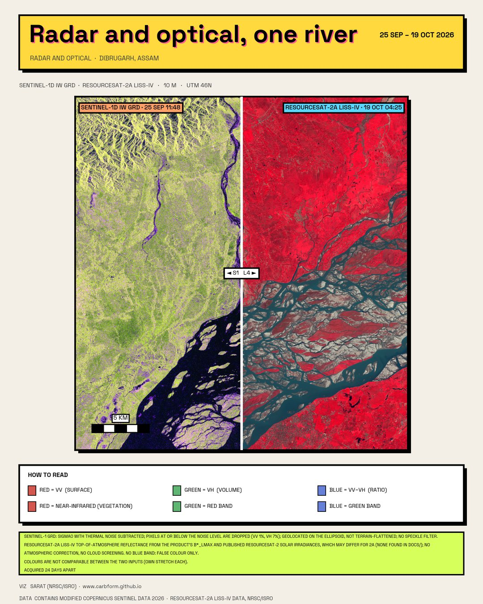
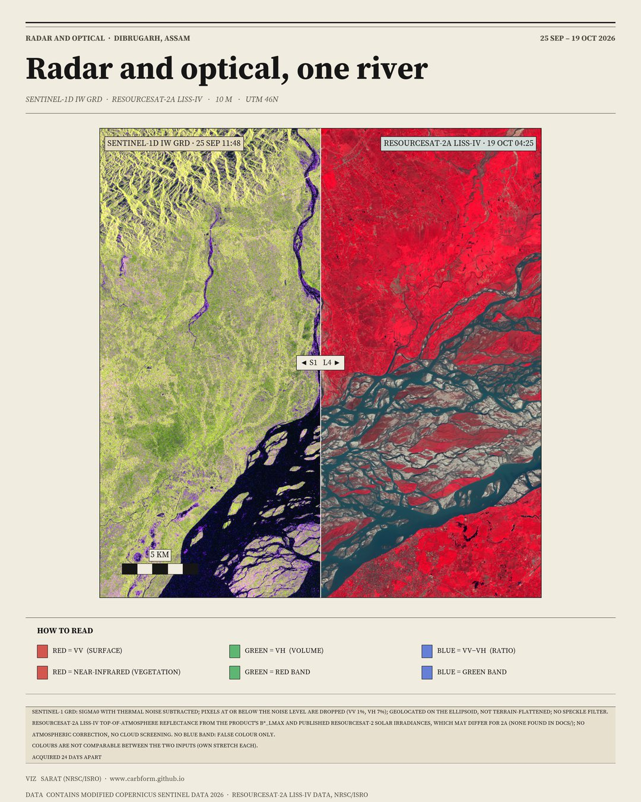
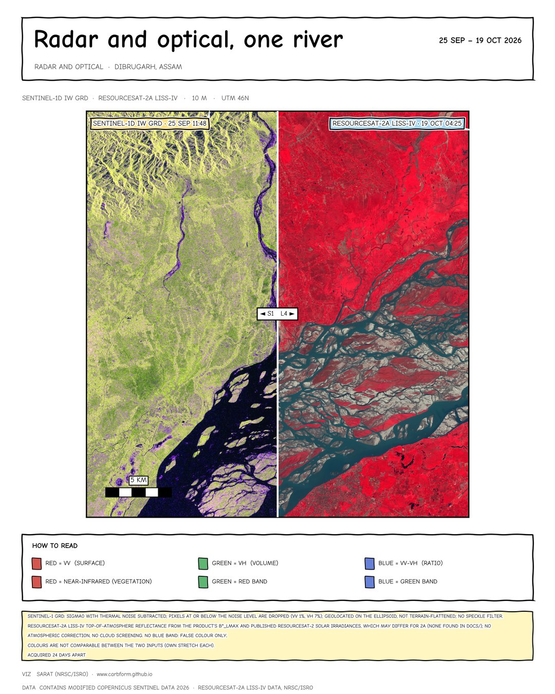

# satviz

Social, publication and editorial infographics from satellite data: SAR (NISAR, EOS-04, Sentinel-1) and optical (Sentinel-2, Landsat, ResourceSat LISS-IV), alone or side by side. NISAR was the first sensor (noise-aware false-colour composites from **L-band** and **S-band** L2 GCOV products).
The first scene is the Brahmaputra near Dibrugarh (Assam), seen by L-SAR and S-SAR on the same pass.

<p align="center">
  
  
</p>

The S-band product is still unfinished: calibration metadata is unpopulated, noise is not subtracted and a flag
(`inputDataExceptionMask` = 64) is undocumented. This code does not hide that. It screens each pixel against the
product's noise floor, draws noise-dominated pixels grey instead of as signal, and prints the caveats on every figure.
Read [docs/processing-notes.md](docs/processing-notes.md) before quoting any number.

## What it does

- Reads an ROI from a GCOV HDF5 file (HH and HV covariance terms, mask, RTC factor, noise-equivalent backscatter).
- Refers the noise floor to γ⁰ (NEBS / η), flags pixels below SNR 3 dB and subtracts noise elsewhere.
- Builds a false-colour composite: R = HH, G = HV (noise-subtracted), B = HH−HV ratio, with per-band or pooled stretch.
- Renders six figures:

| `satviz render …` | Output | Style |
|---|---|---|
| `sband-social` / `lband-social` | One band: full-width composite and the three bands it is built from, 4:5 | neo-retro |
| `ls-social` | L|S split view with three zoom pairs, 4:5 | neo-retro ([design notes](docs/design-language.md)) |
| `ls-clean` | Two large maps, compact header and footer | clean white, [preview](docs/img/clean.jpg) |
| `ls-publication` | Composites, HH L-vs-S density, HV SNR distributions; PNG + PDF | journal-style, one pooled stretch |
| `sband-publication` | S-band alone: HH, HV, composite, SNR; PNG + PDF | journal-style |

## Job files: fill in a config, run one command

```bash
satviz init                              # list presets (sar, sar-compare, optical, sar-vs-optical, multi-sensor-grid)
satviz list                              # sensors, recipes, themes and what each template does
satviz init sar-compare -o job.toml      # write a starter file
# edit the area, the data files and the wording
satviz run job.toml --out outputs/
```

A job file says where (`[area]`: `center` + `radius_km` or `size_km`, or a `bbox`), which data (`[[inputs]]`: an `id`,
a `sensor` and a `source` path or glob), optional `[[zooms]]` by place, and which figures (`[[figures]]`: a `template`
(see [Templates](#templates)), `inputs`, `theme` or a list of themes, `text = { title = "...", subtitle = "..." }`, and
optionally an `arrangement`). Place names, titles and credits are yours to write. A worked
example is [jobs/brahmaputra_l_vs_s.toml](jobs/brahmaputra_l_vs_s.toml), which reproduces the L-vs-S and S-band graphics
exactly. The area defines one pixel grid and every input is read onto it, so the inputs always line up. Grids that
already match are copied, others are resampled. A `<job>.lock.json` next to the outputs records the grid, the input files and the catalogue scenes that were chosen
(it documents a run; to repeat a scene exactly, pin it with `item = "..."`). The built-in wording needs no layout file; sensors add their own attribution and caveats (calibration state,
noise screening) and these cannot be removed.

### Inputs: SAR, optical, anything with a GeoTIFF

| `sensor` | Data | `source` | Notes |
|---|---|---|---|
| `nisar_gcov` | NISAR L2 GCOV (L-SAR, S-SAR) | `{ path = "file or glob" }` | local files; noise-screened false colour |
| `sentinel2_l2a` | Sentinel-2 surface reflectance | `{ stac = "earth-search", date = "2026-09-25" }` | free, no login |
| `sentinel2_safe` | Sentinel-2 L2A, all 12 bands, from a `.SAFE` folder | `{ path = "S2C_MSIL2A_….SAFE" }` (unzipped) | local; each band at its native resolution; wavelengths from the metadata |
| `landsat_c2l2` | Landsat 8/9 Collection 2 Level 2 | `{ stac = "planetary-computer", date = ... }` | free, anonymous token |
| `eos04` | EOS-04 (RISAT-1A) SAR, Level-2B gamma0 ARD (MRS) | `{ path = "E04_…" }` (unzipped product folder) | local; calibrated per the EOS-04 format document; layover/shadow masked; `backscatter = "gamma0"` (default) or `"sigma0"` |
| `sentinel1_grd` | Sentinel-1 IW GRD (VV/VH) from a `.SAFE` folder | `{ path = "S1…SAFE" }` (unzipped) | local; sigma0 with noise subtracted; GCP geolocation, not terrain-flattened |
| `liss4` | ResourceSat-2 and 2A LISS-IV (NRSC/ISRO), green/red/NIR at 5 m | `{ path = "R2F…" }` (unzipped product folder) | local; TOA reflectance from the `.meta`; false colour only |
| `sentinel1_rtc` | Sentinel-1 RTC (VV/VH) | `{ stac = "planetary-computer", date = ..., orbit = "ascending" }` | no noise floor published; the figure says so |
| `geotiff` | anything else: ResourceSat, ALOS PALSAR RTC, PlanetScope, ... | `{ path = "scene.tif" }` | band map in the job file, see [sensors/geotiff.py](src/satviz/sensors/geotiff.py) |

Catalogue inputs need network and `pip install "satviz[optical]"`. The scene is the one closest to `date` (within
`window_days`) whose **cloud cover over your area** (not the tile-wide figure) is at most `max_cloud` and that covers at
least `min_coverage` of it; pin one with `item = "..."`. `satviz search job.toml` lists what would be used. Reflectance
scaling is read from each scene's own metadata. Clouds are shown, not masked, and the figure states the cloud share.
Each sensor adds its own attribution (Copernicus, USGS, NISAR) and caveats; they cannot be removed from a figure. When
inputs are from different days the header shows every date and time. Pixels coarser than the canvas are resampled, and a
notice says so.

<p align="center">
  
  
</p>

## Templates

A **template** says what a figure is about. It checks the inputs, picks a recipe for each, decides how they sit on the page
(the **arrangement**) and states how the products relate. A **theme** only styles the chrome around the data.

| `template` | Takes | Default page | What the figure also says |
|---|---|---|---|
| `optical` | optical inputs | one figure per input | the sensor's own notices (cloud share, no blue band) |
| `sar` | SAR inputs | one figure per input | noise handling, calibration state |
| `optical_sar` | at least one SAR and one optical | split view, SAR left | days between the acquisitions |
| `sar_vs_sar` | two or more SAR | split view per pair | how they relate, below |
| `multispectral` | one optical product per figure | `bands`: a panel per spectral band | the sensor's own notices; no comparison |

`sar_vs_sar` reads the relation from the products and prints it as the subtitle and one notice line: **same sensor in two
bands** (NISAR L and S), **same band from different sensors** (EOS-04 and Sentinel-1, both C-band), or **different sensors
and bands**; with the wavelengths, the time between acquisitions, and a warning when backscatter conventions differ
(σ⁰ ellipsoid against γ⁰ terrain-corrected: not directly comparable). Optical pairs get the same treatment for reflectance level (Sentinel-2 L2A is
surface reflectance, LISS-IV top-of-atmosphere). Bands and wavelengths come from each file's own
frequency, never from a table.

`multispectral` is separate on purpose: it shows one product band by band (Sentinel-2's 12 bands, LISS-IV's 3), each panel in linear grey on
one shared stretch so brightness ratios between bands stay real (`stretch = "per-band"` gives each its own, with the limits on its label), labelled
with the band id, centre wavelength (or nominal range) and native pixel size. `composites = ["true_colour", "nir_fcc"]` appends colour composites; they are
off by default. It never compares and refuses SAR inputs.

`arrangement = "single" | "compare" | "grid"` overrides the page: `grid` tiles two to six inputs, `compare` splits one
canvas between two. `single`, `compare` and `grid` also work as templates for older job files: no checks, no relation text.
If a figure names no recipe, SAR inputs get `sar_fcc`; optical inputs get `true_colour` when they have a blue band and
`nir_fcc` when they do not (LISS-IV). Other recipes: `swir_fcc`, `ndvi`, `ndwi`; `recipes = { E = "sar_fcc", L4 = "ndvi" }`
sets one per input.

<p align="center">
  
</p>

## Themes

Five looks. The data panels are identical in every theme (a test compares the pixels); only the chrome changes.

<p align="center">
  
  
  
  
  
</p>

`neo_retro`, `minimal`, `neo_brutal`, `newspaper` (kicker, headline and dek between rules, serif type, hairline column
rules; inspired by a printed page, no real masthead) and `xkcd` (hand-drawn chrome in a comic typeface; the sketch effect is
removed inside every data axes, so scale bars, zoom boxes and the split line stay exact). `theme = ["minimal", "xkcd"]` writes one
file per theme. A theme is a dozen tokens in `src/satviz/themes/` (copy `minimal.py`); one that needs another structure can
also supply `chrome` with its own `header` and `block`, as `newspaper.py` does. Text tokens must reach 4.5:1 contrast on their
backgrounds; a test enforces it. Older `satviz render` figures take `--theme`; the clean and publication figures stay plain on purpose.

## Install

Python 3.11 or newer.

```bash
git clone <this repo> && cd satviz
python -m venv .venv && source .venv/bin/activate
pip install -e ".[dev]"
```

## Data

No data are stored here. You need two NISAR GCOV granules from the same pass, obtained from the official NISAR
distribution channels (check the provider's terms of use). The Brahmaputra scene expects:

```
NISAR_S2_PR_GCOV_031_112_A_016_3700_DHNA_A_20260925T225740_20260925T225816_P00500_M_F_I_001.h5   (S-SAR)
NISAR_L2_PR_GCOV_031_112_A_016_4005_DHDH_A_20260925T225740_20260925T225815_P05023_N_F_J_001.h5   (L-SAR)
```

Other local products go in `data/` too, unzipped: the NRSC downloads (EOS-04 `E04_…`, LISS-IV `R2F…`) as folders and the Sentinel-1 `.SAFE` as a folder. The third-party handbooks the readers follow are listed in [docs/references/](docs/references/README.md).

Put them in `data/` (ignored by git), or point the tool elsewhere with `--data-dir /path/to/granules` or
`export SATVIZ_DATA_DIR=/path/to/granules` (the old `NISAR_DATA_DIR` still works). Lookup order: `--data-dir`, `$SATVIZ_DATA_DIR`, `./data`, the current directory. Reading a slice from these multi-GB files can be slow, so ROIs are cached as `.npz`
in `cache/` (invalidated automatically if the source file changes; `--no-cache` to disable).

## Usage

`satviz render` is the older NISAR-only path, kept under `legacy/`; new work uses `satviz run` with a job file. Run from the repository root (the default `--config` is `legacy/configs/brahmaputra.toml`).

```bash
satviz render all                                       # granules in ./data; writes to outputs/
satviz render ls-social ls-clean --out figs/
satviz render ls-social --pooled-stretch                # same colours in both bands (default: each band on its own)
satviz stats --data-dir /path/to/granules               # noise fractions, backscatter percentiles per band
python -m satviz render ls-publication                  # same as the console script
```

## Layout files: change the wording without touching code

What is written on each figure lives in a wording file, e.g. `legacy/layouts/<figure>.toml` (`sband_social.toml` and `lband_social.toml` for the
single-band graphics, plus the four L-vs-S and publication files): main title, subtitle, info line, the how-to-read
legend, the bottom notes, the credits and the publication captions. Edit them freely.

```toml
# legacy/layouts/ls_social.toml
[header]
title = "River Brahmaputra"
subtitle = "THE {name_upper} AS SEEN BY NISAR"
date = "{date_upper}"                      # <- from the file, not typed
info_line = "... TRACK {track} · FRAME {frame}"
[notes]
lines = [
  { if = "uncal_bands", text = "{uncal_bands_upper} CALIBRATION METADATA NOT YET POPULATED ..." },
  "{stretch_warning_upper} NOISE-SCREENED (SNR < 3 dB GREY), SPECKLE FILTER NOT APPLIED",
]
```

Facts are **never typed in a layout**. Placeholders such as `{date}`, `{time_utc}`, `{track}`, `{frame}`,
`{pass_direction}`, `{posting_m}`, `{crs}`, `{L.wavelength_cm:.0f}`, `{S.freq_ghz:g}`, `{S.crid}` and the noise
percentages `{S.noisy_hv_pct:.0f}` are read from the granule metadata and the data (the identification group,
swath, calibration and processing-parameter groups). `{x_upper}` is the upper-case form of `{x}`, and `{x!u}` upper-cases any value (e.g. `{L.rfi!u}`). The colour-stretch
limits of the single-band graphics are `{lim.HH_lo}`, `{lim.HH_hi}`, `{lim.HV_lo}` and so on. List all of them
with their values:

```bash
satviz placeholders --data-dir /path/to/granules
```

Two safeguards: a line written as `{ if = "uncal_bands", text = "..." }` shows only while a band's calibration scale
factors are zero in the file, so the provisional-calibration warning disappears by itself when ISRO populates them; and
the tool refuses to build a figure from two granules that are not the same track, frame and pass direction. Unknown
placeholders and over-long lists fail with the file name and the valid choices. `satviz render --layouts-dir DIR`
uses another set of layout files.

## Another scene

A scene for the older `render` path is one TOML file ([legacy/configs/brahmaputra.toml](legacy/configs/brahmaputra.toml)): a list of `[[inputs]]` (an `id`, the
`sensor` reader that handles it, the file, and that reader's options; for NISAR the HDF5 group and the ROI rows and
columns in each file's own grid; the first input is the reference for shared facts such as track and CRS), zoom windows, callouts and the place names (`name`, `reach`, `region`, author,
website). Date, pass and instrument facts are not in it; they come from the files. Copy it, edit it and pass
`--config`. The L-band and S-band ROIs must cover the same ground; check that the `x`/`y` coordinates match before
building a split view.

## Layout

```
src/satviz/
  core.py         Product, Rendered, registries for sensors, recipes, templates, themes
  registry.py     loads the built-in plugins; `satviz list`
  sensors/        one module per sensor: nisar_gcov/, eos04, sentinel1_grd, sentinel1 (RTC), sentinel2 (catalogue), sentinel2_safe (local), landsat, liss4, geotiff
                  nrsc.py (shared NRSC metadata parser), stac_optical.py (shared catalogue reader)
  recipes/        sar_fcc (SAR false colour), optical (true colour, NIR/SWIR false colour, NDVI, NDWI), bands (single-band grey panels)
  templates/      scenarios: optical, sar, multispectral, optical_sar, sar_vs_sar (+ single/compare/grid as bare arrangements)
  relations.py    how the products of a figure relate (band, sensor, time gap, backscatter convention)
  radar.py        radar band and wavelength from a centre frequency
  arrangements/   single, compare, grid, bands: where products sit on the page; `draw` runs one
  themes/         base.py (Theme tokens + chrome), neo_retro, minimal, neo_brutal, newspaper, xkcd
  area.py, grid.py, job.py, run.py, sources.py   area -> canvas grid, resampling, job file, runner, data paths
  config.py, layout.py, geo.py, cog.py            scene dataclasses, wording files + placeholders, projections, GeoTIFF windows
  presets/, layouts/    starter job files and built-in wording (shipped with the package)
  legacy/         the NISAR-only figures behind `satviz render` (clean, publication)
  cli.py          satviz entry point (`nisar-viz` and `python -m nisar_viz` are aliases)
jobs/             worked job files: Dibrugarh (NISAR, Sentinel-1, EOS-04, Sentinel-2, LISS-IV) and their template variants
legacy/           configs/ and layouts/ for `satviz render`
docs/             architecture, pipelines, processing notes, design language; references/ lists the (git-ignored) PDFs
tests/            synthetic-data tests (no granules needed)
archive/          earlier scripts and design explorations, unmaintained
```

## Fonts

Figures use IBM Plex Sans / Mono and Gillius ADF (neo-retro), Source Serif Pro (newspaper) and Humor Sans or Comic Neue (xkcd) if installed, and fall back to DejaVu otherwise; the layout
holds either way, but renders are only pixel-identical on a machine with the same fonts.

## Development

```bash
pytest -q          # synthetic granules, runs in seconds
ruff check .
```

CI runs both on Python 3.11 and 3.12.

## Caveats in one place

- S-band calibration scale factors are zero in the product: S-band dB is relative, and the L−S offset is provisional.
- 39 % (S) and 36 % (L) of 10 m HV pixels are below the noise threshold, mostly open water. The figure shows them grey.
- The noise layer is documented as σ⁰-referenced, so the γ⁰ floor is NEBS / η. If it were γ⁰-referenced the fractions would be 23 % and 25 %.
- L-band RFI mitigation was not applied; S-band ionospheric geolocation correction was not applied.
- The S-band exception code 64 (72 % of the ROI) is undocumented; no radiometric step was found, geolocation not tested.

Details and the open questions for the data provider are in [docs/processing-notes.md](docs/processing-notes.md).

## Licence

Code: MIT, see [LICENSE](LICENSE). NISAR data and the source documents belong to their providers (NASA/JPL and
ISRO); figures derived from them should credit "NASA-ISRO NISAR".
